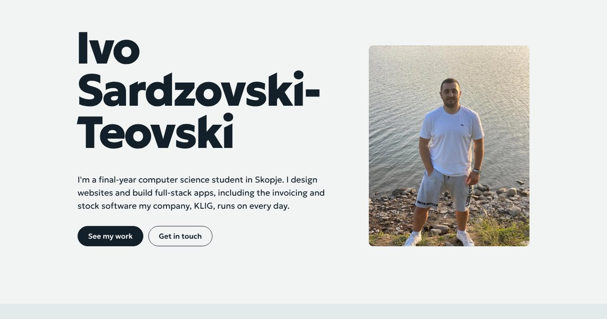

# Ivo Sardzovski-Teovski · Portfolio

My personal portfolio website, live at **[ivot7.github.io/IvoT7](https://ivot7.github.io/IvoT7/)**.

I'm a final-year computer science student at University American College Skopje. I design websites and build full-stack apps, including the invoicing, stock and point-of-sale system my company, KLIG, uses every day.



## What's on the site

- **Work**: the KLIG business system, with a small interactive demo of how its stock is calculated from movements; FinKompas, my team's entry for the NBRM hackathon; and the SEMOS Education website.
- **About**: who I am, what I'm working on now, and what I can build for you.
- **Skills**: front end, back end, databases, tools and languages.
- **Contact**: email, CV download and a message form that opens your email app.

## Built with

- Plain **HTML, CSS and JavaScript**, with no frameworks and no build step
- **Geologica** typeface, self-hosted in `fonts/` (SIL Open Font License)
- Responsive layout with CSS Grid and container query units
- Accessible by default: skip link, visible keyboard focus, labelled form fields, and reduced motion respected
- Hosted for free on **GitHub Pages**

## Project structure

```
IvoT7/
├── index.html        page content
├── style.css         all styling (colours and type sizes are at the top)
├── script.js         mobile menu, stock demo, contact form
├── favicon.svg       browser tab icon
├── fonts/            Geologica font files and licence
└── images/           photos, CV and social preview image
```

## Run it locally

No install needed. Either open `index.html` in a browser, or serve the folder so the fonts load the same way they do online:

```bash
python -m http.server 8000
# then open http://localhost:8000
```

## Update the live site

The site is published by GitHub Pages from the `main` branch. Any change pushed to `main` goes live in about 1–2 minutes:

```bash
git add .
git commit -m "Describe your change"
git push
```

## Contact

- Email: [ivosardzovski@hotmail.com](mailto:ivosardzovski@hotmail.com)
- Location: Skopje, North Macedonia

© 2026 Ivo Sardzovski-Teovski
